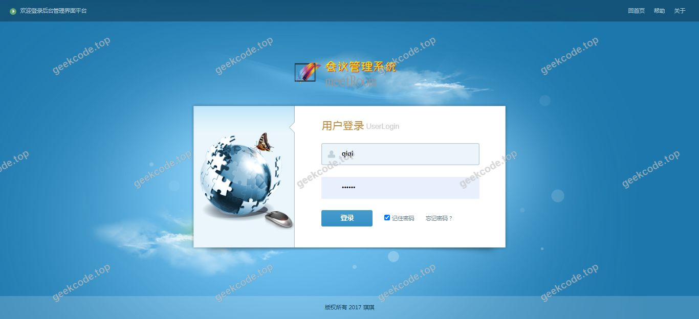
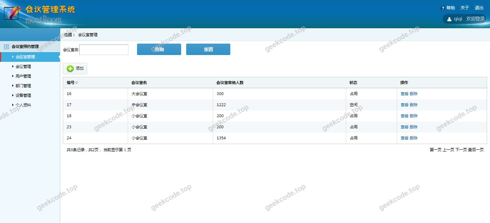
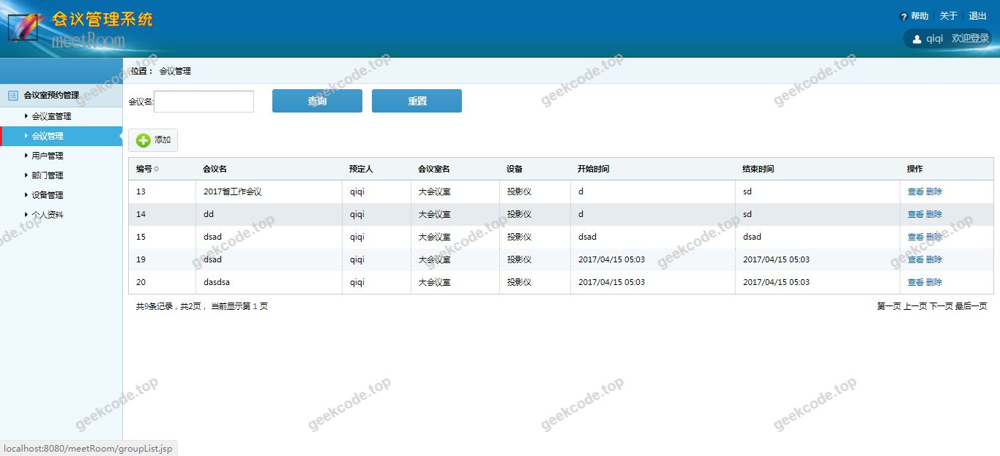
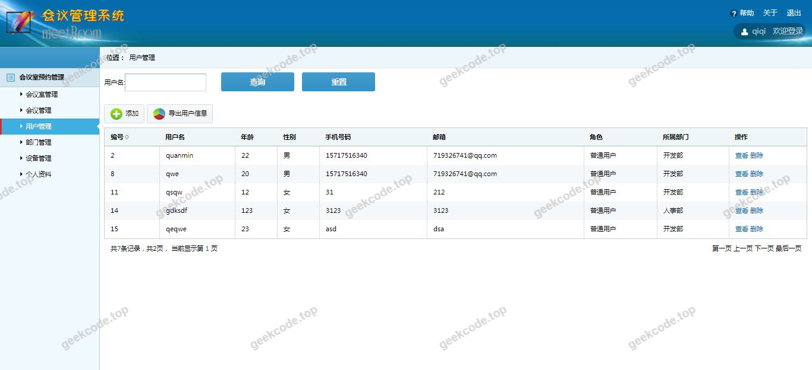
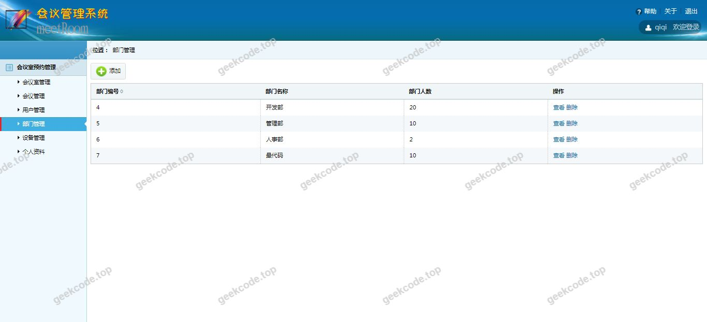
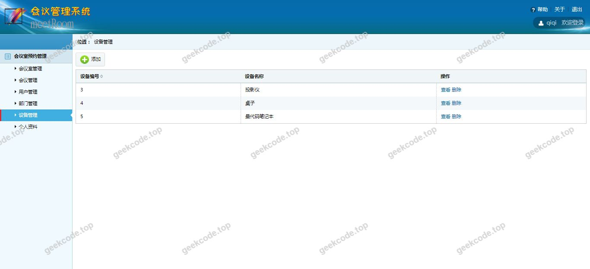
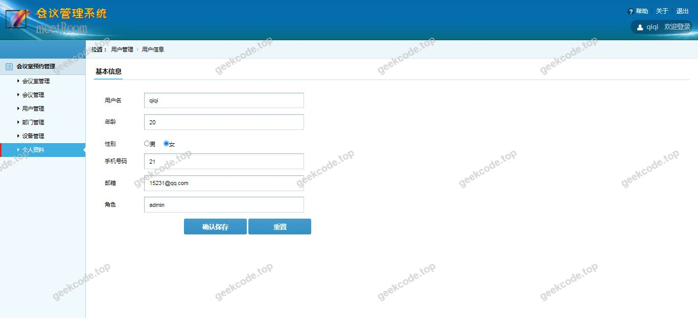

# java项目-SSM的会议室管理系统-【毕业设计】精品项目

> 🎓 **计算机毕业设计 · java项目-SSM的会议室管理系统-【毕业设计】精品项目**
>
> 本仓库只放**项目介绍 + 运行截图**（截图是站点带水印的原图，存在仓库 `images/` 里）。
>
> 👉 **完整可运行源码 / 数据库脚本 / 部署文档：[点我获取](https://geekcode.top/archives/java%E9%A1%B9%E7%9B%AE-SSM%E7%9A%84%E4%BC%9A%E8%AE%AE%E5%AE%A4%E7%AE%A1%E7%90%86%E7%B3%BB%E7%BB%9F-%E3%80%90%E6%AF%95%E4%B8%9A%E8%AE%BE%E8%AE%A1%E3%80%91%E7%B2%BE%E5%93%81%E9%A1%B9%E7%9B%AE?utm_source=github)**
>
> 💬 咨询微信：**ir9372**　|　🌐 更多项目：[极客代码 geekcode.top](https://geekcode.top/?utm_source=github)
>
> 📌 项目详情页：<https://geekcode.top/archives/java%E9%A1%B9%E7%9B%AE-SSM%E7%9A%84%E4%BC%9A%E8%AE%AE%E5%AE%A4%E7%AE%A1%E7%90%86%E7%B3%BB%E7%BB%9F-%E3%80%90%E6%AF%95%E4%B8%9A%E8%AE%BE%E8%AE%A1%E3%80%91%E7%B2%BE%E5%93%81%E9%A1%B9%E7%9B%AE?utm_source=github>

<table><td width="230" align="center"> <b>扫码加微信 ir9372</b></td><td valign="middle">📦 源码 = 项目介绍 + 全部运行截图 + 数据库 + 部署文档 👉 点上方任意截图，直接跳到 <b>极客代码 geekcode.top</b> 详情页</td></table>

---

<h1>java项目-SSM的会议室管理系统-【毕业设计】精品项目</h1>
<h2>项目概述</h2>

本项目为基于 SSM（Spring + Spring MVC + MyBatis）框架开发的会议室管理系统，旨在解决企事业单位或高校内部会议室资源分配不均、预约流程繁琐及状态管理混乱等问题。系统采用 JSP 作为前端页面技术，后端通过 Java 语言实现业务逻辑与数据持久化。核心功能涵盖会议室基本信息管理、预约申请处理、使用状态实时监控等模块。该项目适用于中小型组织内部的行政管理部门，帮助管理员高效调度场地资源，同时为员工或学生提供便捷的查询与预约入口。整体架构遵循 MVC 设计模式，实现了视图层、控制层与模型层的解耦，具备良好的可维护性与扩展性，符合计算机专业毕业设计对于完整 Web 应用开发的要求。

<h2>技术架构</h2>

本系统采用经典的三层架构设计，具体技术选型如下：

<ol>
<li><strong>表现层 (View)</strong>：使用 JSP (JavaServer Pages) 技术构建用户界面，结合 HTML/CSS/JavaScript 实现页面渲染与交互。JSP 能够直接嵌入 Java 代码片段，适合快速开发动态网页内容。</li>
<li><strong>控制层 (Controller)</strong>：基于 Spring MVC 框架，负责接收 HTTP 请求，调用业务逻辑组件，并返回相应的视图或数据。通过 DispatcherServlet 统一分发请求，利用注解简化配置。</li>
<li><strong>业务逻辑层 (Service)</strong>：由 Spring 框架管理 Bean 的生命周期与依赖注入，处理核心业务规则，如会议室可用性校验、预约冲突检测等。</li>
<li><strong>数据访问层 (DAO)</strong>：采用 MyBatis 框架进行数据库操作。MyBatis 支持 SQL 语句与 Java 代码的灵活映射，便于优化复杂查询性能，并通过 XML 配置文件或注解方式定义 Mapper 接口。</li>
<li><strong>数据库</strong>：使用 MySQL 关系型数据库存储会议室信息、用户数据及预约记录。设计上注重表结构的规范化，确保数据的一致性与完整性。</li>
</ol>

该架构组合成熟稳定，社区资源丰富，适合毕业设计场景下的快速开发与调试。

<h2>功能模块</h2>

根据提供的截图列表及项目名称，系统主要包含以下功能模块（注：由于未提供详细的前后台路由及代码上下文，以下模块描述基于“会议室管理系统”的标准功能范畴及截图所示的系统运行界面推导）：

<h3>前台用户端功能</h3>
<ul>
<li><strong>会议室浏览</strong>：展示所有可用会议室的基本信息，包括名称、容纳人数、设备配置等。</li>
<li><strong>预约申请</strong>：用户选择特定时间段和会议室提交预约请求，系统需验证时间冲突。</li>
<li><strong>我的预约</strong>：查看个人历史预约记录及当前待审核或已批准的预约状态。</li>
<li><strong>个人中心</strong>：修改基本个人信息，如联系方式、密码等。</li>
</ul>
<h3>后台管理端功能</h3>
<ul>
<li><strong>会议室管理</strong>：管理员对会议室信息进行增删改查操作，设置会议室状态（启用/停用）。</li>
<li><strong>预约审批</strong>：处理用户提交的预约申请，执行批准或拒绝操作，并通知用户结果。</li>
<li><strong>用户管理</strong>：管理系统注册用户，重置密码或禁用违规账号。</li>
<li><strong>数据统计</strong>：查看会议室使用频率、热门时段等基础统计信息，辅助资源调配决策。</li>
</ul>
<h2>用户角色与权限</h2>

系统主要涉及两类用户角色，其权限划分如下：

<table>
<thead>
<tr>
<th align="left">角色</th>
<th align="left">权限描述</th>
</tr>
</thead>
<tbody><tr>
<td align="left"><strong>普通用户</strong></td>
<td align="left">1. 登录系统。2. 浏览会议室列表及详情。3. 发起会议室预约申请。4. 查看和管理个人的预约记录。5. 修改个人账户信息。</td>
</tr>
<tr>
<td align="left"><strong>管理员</strong></td>
<td align="left">1. 登录后台管理系统。2. 全面管理会议室资源（新增、编辑、删除、状态变更）。3. 审核用户的预约申请（批准、驳回）。4. 管理用户账户（查看、重置密码、冻结/解冻）。5. 查看系统运行日志或统计数据（若存在相关模块）。</td>
</tr>
</tbody></table>
<h2>项目特色与创新点</h2>
<ol>
<li><strong>轻量化架构</strong>：采用 SSM 经典组合，相较于微服务架构，部署简单，资源占用低，非常适合中小规模应用场景及教学演示。</li>
<li><strong>直观的状态反馈</strong>：通过 JSP 页面实时呈现会议室占用情况，避免传统纸质登记或 Excel 表格带来的信息滞后问题。</li>
<li><strong>标准化流程</strong>：内置预约申请与审批工作流，规范了会议室使用的内部管理秩序，减少了人为协调成本。</li>
<li><strong>易于二次开发</strong>：分层结构清晰，各层职责单一，便于后续扩展如集成邮件通知、短信提醒或移动端适配等功能。</li>
</ol>
<h2>部署环境</h2>

为确保系统正常运行，需准备以下软件环境：

<ul>
<li><strong>操作系统</strong>：Windows 7/10/11, Linux (CentOS/Ubuntu), macOS 均可。</li>
<li><strong>JDK</strong>：Java Development Kit 8 或更高版本（建议 JDK 1.8），用于编译和运行 Java 代码。</li>
<li><strong>Web 服务器</strong>：Apache Tomcat 8.5 或 9.x 版本，用于部署 WAR 包及运行 JSP 页面。</li>
<li><strong>数据库</strong>：MySQL 5.7 或 8.0 版本，需安装 MySQL Server 客户端工具以便导入 SQL 脚本。</li>
<li><strong>开发工具</strong>：IntelliJ IDEA 或 Eclipse，配合 Maven 构建工具（若项目使用 Maven 管理依赖）。</li>
<li><strong>浏览器</strong>：Chrome, Firefox, Edge 等主流现代浏览器，以兼容 JSP 生成的 HTML/CSS/JS 内容。</li>
</ul>
<h2>五、技术特性</h2>
<ul>
<li>服务端模板渲染（JSP）</li>
</ul>
<h2>六、功能模块截图</h2>
<h3>前台用户端</h3>
<h4>系统运行界面1</h4>

<h4>系统运行界面2</h4>

<h4>系统运行界面3</h4>

<h4>系统运行界面4</h4>

<h4>系统运行界面5</h4>

<h4>系统运行界面6</h4>

<h4>系统运行界面7</h4>

---

## 获取完整源码

| 项目 | 说明 |
| --- | --- |
| 项目名 | java项目-SSM的会议室管理系统-【毕业设计】精品项目 |
| 运行截图 | 本文 7 张（站点带水印原图，仓库 `images/` 目录） |
| 完整源码 | [https://geekcode.top/archives/java%E9%A1%B9%E7%9B%AE-SSM%E7%9A%84%E4%BC%9A%E8%AE%AE%E5%AE%A4%E7%AE%A1%E7%90%86%E7%B3%BB%E7%BB%9F-%E3%80%90%E6%AF%95%E4%B8%9A%E8%AE%BE%E8%AE%A1%E3%80%91%E7%B2%BE%E5%93%81%E9%A1%B9%E7%9B%AE?utm_source=github](https://geekcode.top/archives/java%E9%A1%B9%E7%9B%AE-SSM%E7%9A%84%E4%BC%9A%E8%AE%AE%E5%AE%A4%E7%AE%A1%E7%90%86%E7%B3%BB%E7%BB%9F-%E3%80%90%E6%AF%95%E4%B8%9A%E8%AE%BE%E8%AE%A1%E3%80%91%E7%B2%BE%E5%93%81%E9%A1%B9%E7%9B%AE?utm_source=github) |
| 咨询微信 | **ir9372**（备注：jingpin-yuanma） |
| 更多项目 | [极客代码 geekcode.top](https://geekcode.top/?utm_source=github) |

> 需要源码、部署、改配置、跑不起来等问题，加微信 ir9372 沟通，说明项目名即可。
